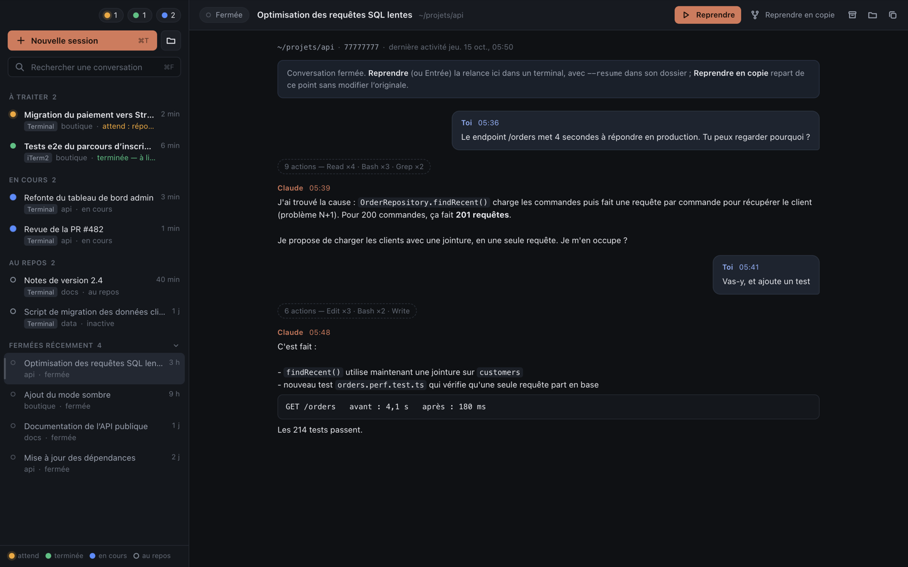

# Claude Deck

**Toutes tes sessions Claude Code au même endroit.** Quand cinq ou six terminaux font tourner Claude Code en
parallèle, on ne sait plus lequel a fini, lequel attend une réponse, lequel travaille encore. Claude Deck les
rassemble dans une seule fenêtre macOS, avec leur statut en couleur, des terminaux intégrés, la recherche dans
l'historique et la reprise en un clic.

*A macOS app that gathers all your Claude Code sessions in one window: live status, embedded terminals,
history search and one-click resume. The interface is in French.*



> Projet indépendant, non affilié à Anthropic.

## Fonctionnalités

- **Toutes les sessions de la machine**, y compris celles lancées dans Terminal.app ou iTerm2, groupées par statut :
  - 🟠 **En attente de toi** : question, boîte de dialogue, demande d'autorisation
  - 🟢 **Terminée, à lire** : Claude a fini et tu n'as pas encore regardé
  - 🔵 **En cours** : Claude travaille
  - ⚪ **Au repos**, ◌ **Fermées récemment**, 🟣 **Agents en arrière-plan** (`claude --bg`)
- **Terminaux intégrés** (xterm.js + node-pty, comme le terminal de VS Code) : la commande de nouvelle session
  s'exécute dans un zsh de login interactif, avec ton `.zshrc`, ton PATH et tes alias. Quand Claude s'arrête, on
  retombe sur le shell.
- **Conversations passées** : aperçu des derniers échanges, **Reprendre** (Entrée) relance la conversation avec
  `--resume` dans son dossier ; **Reprendre en copie** ajoute `--fork-session`.
- **Recherche** (`⌘F`) dans les titres, les dossiers, tous tes prompts et les réponses de Claude, sur toutes les
  conversations encore reprenables.
- **Archivage** (`⌃⌘A`) : la conversation sort de la liste et revient d'elle-même si elle reprend vie.
- **Sessions de Terminal.app** : « Afficher » sélectionne le bon onglet ; « Rapatrier » arrête la session là-bas et
  la reprend dans Claude Deck.
- **Suivi de chaque session** : contexte utilisé (jauge orange dès 70 %, rouge dès 90 %), ce que Claude fait en ce
  moment (« Bash · npm test », « Edit · main.js »), durée et nombre d'actions du tour en cours, branche git.
- **Forfait Claude** : pourcentages de la session de 5 h et de la semaine, comme `/usage`, avec l'heure de remise à
  zéro et le rythme (« à ce rythme, 100 % vers 15:20 »). Vue **Statistiques** (`⇧⌘U`) : historique des pourcentages,
  activité sur 30 jours, répartition par dossier.
- **Notifications** quand une session termine ou t'attend, **badge du Dock** et **compteur dans la barre des menus**.
- **Mises à jour automatiques** depuis les releases GitHub, signées.

## Installation

Prérequis : macOS sur Apple Silicon, [Claude Code](https://docs.claude.com/en/docs/claude-code) installé.

1. Télécharge le `.dmg` de la [dernière release](https://github.com/bartolije/claude-deck/releases/latest) et glisse
   Claude Deck dans **Applications**.
2. L'appli n'est pas signée par un compte développeur Apple : au premier lancement, fais **clic droit › Ouvrir**
   (ou `xattr -dr com.apple.quarantine "/Applications/Claude Deck.app"`).
3. Pour la garder sous la main : clic droit sur l'icône du Dock › Options › Garder dans le Dock, et si tu veux,
   menu Claude Deck › **Ouvrir à l'ouverture de session**.

Les mises à jour s'installent ensuite toutes seules : téléchargées en arrière-plan, appliquées au prochain
redémarrage de l'appli (bouton « Redémarrer » dans la barre latérale).

## Réglages

`⌘,` ouvre les Réglages de l'appli, enregistrés aussitôt :

- **Général** : ouverture à l'ouverture de session, compteur dans la barre des menus, badge du Dock, notifications
  (avec ou sans son), suivi du forfait en direct, mises à jour automatiques.
- **Sessions** : commandes de nouvelle session, de session dans un dossier et de reprise, shell, profondeur de
  « Fermées récemment », délai de grisage, agents en arrière-plan.
- **Terminal** : police, taille, interligne, affichage de Claude (plein écran ou classique), vitesse de la molette.
- **Raccourcis** : tous modifiables (clic, puis la combinaison ; ⌫ pour aucun), doublons signalés, et un raccourci
  global qui affiche ou masque Claude Deck depuis n'importe quelle appli.
- **Autorisations** : état des accès macOS et bouton pour les demander ou ouvrir la bonne page des Réglages système.
- **Avancé** : `config.json` et dossier des données.

Les mêmes réglages sont dans `~/Library/Application Support/Claude Deck/config.json` (rechargé à l'enregistrement) :

| Clé | Défaut | Rôle |
| --- | --- | --- |
| `newSessionCommand` | `claude` | Commande d'une nouvelle session. Un alias de ton `.zshrc` marche (par exemple `alias cc="cd ~/work && claude --model opus"`) |
| `newSessionInFolderCommand` | `cd {cwd} && claude` | Nouvelle session dans un dossier choisi (`⇧⌘T`) |
| `resumeCommand` | `cd {cwd} && claude --resume {sessionId}` | Reprise d'une conversation |
| `attachCommand` | `claude attach {id}` | Ouvrir un agent en arrière-plan |
| `shell` | `$SHELL` | Shell des terminaux intégrés |
| `closedSessionsDays` | `3` | Profondeur de « Fermées récemment » (la recherche couvre tout l'historique conservé) |
| `staleAfterHours` | `6` | Au-delà, une session au repos est grisée |
| `notifications`, `notificationSound` | `true` | Notifications macOS, avec ou sans son |
| `showTray`, `showDockBadge` | `true` | Compteur dans la barre des menus, badge du Dock |
| `showBackgroundAgents` | `true` | Section des agents en arrière-plan |
| `fontFamily`, `fontSize`, `lineHeight` | SF Mono 11, 1 | Police des terminaux (`⌘+`, `⌘−`, `⌘0`) |
| `scrollSpeed` | `1` | Vitesse de la molette (menu Présentation) |
| `claudeDisplay` | `auto` | Rendu de Claude : `auto` (ton réglage `/tui`), `classic` (historique et barre de défilement), `fullscreen` |
| `autoUpdate` | `true` | Recherche des nouvelles versions au démarrage puis toutes les 6 h |
| `shortcuts` | voir ci-dessous | Raccourcis des menus (accélérateurs Electron, `""` = aucun) |
| `globalShortcut` | `""` | Raccourci global pour afficher ou masquer l'appli, par exemple `Alt+Space` |

## Usage du forfait

Claude Deck ne lit jamais tes identifiants Claude. Les pourcentages viennent de deux sources :

- **Le cache de `/usage`** : Claude Code garde dans `~/.claude.json` le dernier relevé fait par `/usage`. Toujours
  disponible, mais seulement aussi frais que ton dernier `/usage`.
- **La barre d'état « pont »** (bandeau « Suivre ton forfait en direct », ou menu Présentation › Barre d'état Claude
  Code) : Claude Deck déclare une barre d'état dans `~/.claude/settings.json` (sauvegardé avant modification dans
  `settings.json.claude-deck-backup`). Après chaque réponse, Claude Code lui transmet le contexte et tes limites
  d'usage ; elle les enregistre dans `~/Library/Application Support/Claude Deck/status/` et affiche une ligne
  `Contexte · Session · Semaine` en bas de tes sessions. Si tu avais déjà une barre d'état, c'est elle qui reste
  affichée. La décocher remet `settings.json` comme avant.

## Raccourcis

| Raccourci | Action |
| --- | --- |
| `⌘T` / `⇧⌘T` | Nouvelle session / dans un dossier |
| `⌘F` | Rechercher (↑ ↓ pour parcourir, Entrée, Échap) |
| `↩` | Action principale : reprendre, afficher, ouvrir |
| `⌃⌘A` | Archiver |
| `⇧⌘U` | Statistiques et usage du forfait |
| `⌘J` | Prochaine session qui t'attend |
| `⌘1` … `⌘9` | Aller à une session (maintenir `⌘` affiche les numéros) |
| `⇧⌘]` / `⇧⌘[` | Session suivante / précédente |
| `⌘W` | Fermer la session (confirmation si Claude tourne) |
| `⇧↩` ou `⌥↩` | Retour à la ligne dans le prompt |
| `⌘-clic` | Ouvrir un lien |

## Comment ça marche

Sans hook ni configuration : Claude Code tient un registre de ses sessions vivantes dans
`~/.claude/sessions/<pid>.json` (statut `idle`, `busy` ou `waiting`). Claude Deck le lit chaque seconde. Titres,
prompts et réponses viennent des transcripts `~/.claude/projects/**/<session>.jsonl` et de `~/.claude/history.jsonl`.
Un terminal intégré est rattaché à sa session par son TTY.

Ces fichiers sont des formats internes de Claude Code, non documentés : une mise à jour de Claude Code peut les
changer. C'est `lib/sessions.js` qu'il faut alors adapter.

En plein écran (`/tui fullscreen`), c'est Claude qui gère son défilement : il n'y a pas de barre de défilement
possible, dans Claude Deck comme dans Terminal.app. Le rendu classique (menu Présentation › Affichage de Claude)
envoie la conversation dans l'historique du terminal, avec une barre de défilement.

## Confidentialité et sécurité

- **Tout reste sur ta machine.** Claude Deck lit les fichiers de Claude Code en local et n'envoie rien. Sa seule
  requête réseau est la vérification des mises à jour sur GitHub. Il ne lit jamais les identifiants de Claude Code.
- **Autorisations macOS.** Les programmes lancés dans les terminaux de Claude Deck (Claude Code, ses serveurs MCP)
  sont rattachés à Claude Deck, comme ils l'étaient à Terminal.app : macOS demande l'accès à Documents, à
  Téléchargements ou aux données d'autres apps la première fois. Une appli ne peut pas s'accorder ces droits
  elle-même ; Réglages › Autorisations fait les demandes d'un coup ou ouvre la bonne page des Réglages système.
  L'accès complet au disque supprime toutes les demandes, mais donne tout le disque à ce qui tourne dans les terminaux.
- **Mises à jour signées.** Le manifeste `latest.json` est signé en Ed25519 ; la clé publique est embarquée dans
  l'appli, la clé privée ne quitte pas la machine de publication. L'URL de l'archive est construite par l'appli, le
  zip doit avoir l'empreinte SHA-256 annoncée, et l'appli extraite doit porter le même identifiant, la bonne version
  et une signature de code valide, émise par la même identité que l'appli installée. Le remplacement se fait après la
  fermeture, avec retour arrière en cas d'échec.
- **Electron verrouillé** : isolation de contexte, sandbox, CSP stricte, aucune navigation ni fenêtre externe,
  permissions web refusées, fusibles `RunAsNode`, `NODE_OPTIONS` et `--inspect` désactivés, débogage distant refusé.
  Les programmes des terminaux peuvent écrire dans le presse-papiers (OSC 52) mais pas le lire.

## Développement

```bash
npm install          # npm 11 : le script d'Electron est autorisé dans allowScripts
npm start            # lance l'appli depuis les sources
npm run package      # dist/build.noindex/Claude Deck-darwin-arm64/Claude Deck.app
npm run install-app  # package + copie dans ~/Applications
```

Structure :

- `main.js` : fenêtre, menus, barre des menus, notifications, IPC, état des sessions, recherche
- `lib/sessions.js` : registre, transcripts, historique, aperçu, terminal hôte, arrêt propre
- `lib/ptys.js` : terminaux intégrés (node-pty)
- `lib/updater.js` : mises à jour signées
- `lib/store.js` : `config.json` et `state.json`
- `renderer/` : interface (HTML, CSS, JavaScript sans framework, xterm.js)

### Publier une version

1. Une fois : `node scripts/gen-update-key.js` crée la clé de signature des mises à jour dans `~/.config/claude-deck/`
   et la clé publique dans `assets/` ; `bash scripts/setup-signing.sh` crée l'identité de signature de code (certificat
   auto-signé dans un trousseau dédié du même dossier). Sauvegarder `~/.config/claude-deck/` : sans ces deux clés, les
   versions installées refusent les mises à jour. L'identité stable permet à macOS de garder les autorisations de
   l'appli (contrôle de Terminal, dossiers…) d'une version à l'autre.
2. Mettre à jour `version` dans `package.json`, ajouter la section `## <version>` en tête de `CHANGELOG.md`, committer.
3. `npm run release` : construit l'appli, le zip, le DMG et `latest.json` signé, pousse le tag et crée la release.
   `npm run release:dry` fait tout sauf publier.

## Licence

MIT
